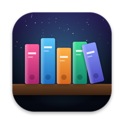

# GameShelf

A themeable game library for macOS. It gathers your DuckStation, PCSX2, Gopher64, Steam and Mac games, plus any decomps and recomps you add, into one window you can drive with a keyboard, mouse or controller.

## Install

```sh
brew tap willsav-3ds/gameshelf
brew trust willsav-3ds/gameshelf
brew install --cask gameshelf
```

Requires macOS 27 on Apple silicon.

## Themes

Eleven themes are built in, across four layouts: Showcase, Carousel, Grid and Bookshelf. Five of them have a moving backdrop that reacts to the pointer: Deep Space, Outrun, Mainframe, Campfire and Abyss.

Covers tilt under the pointer, and the cover in a game's details can be grabbed and turned.

Everything is adjustable in Settings > Appearance. Themes are JSON files in `~/Library/Application Support/GameShelf/Themes`, so they can be shared and edited by hand.

## Build

Open `GameShelf.xcodeproj` in Xcode and run. Signing is set to a specific development team, so change it to your own in the target's Signing & Capabilities.
